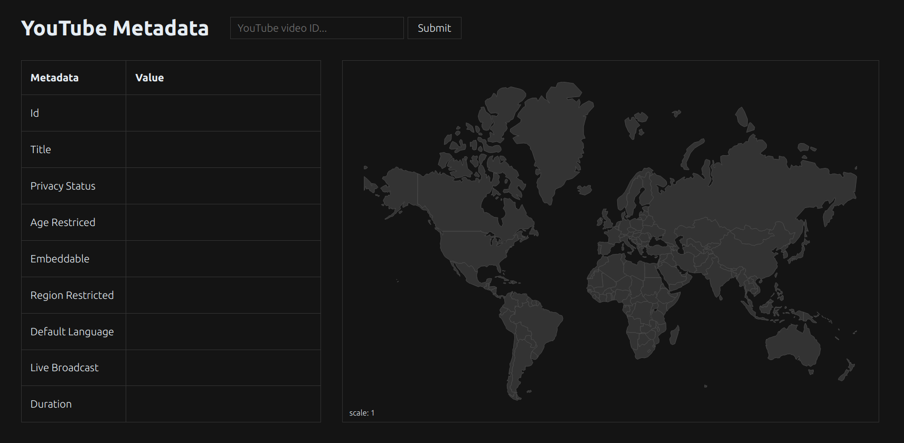

# YouTube Metadata

Supply a YouTube video URL to get some of the essential info about the video.

## Config

Create an `.env` file with `PORT` and `YOUTUBE_API_KEY` variables or export tme to your environment.

## Installation

Consult the Makefile for the commands.

Or just use `air` if you want live reloading for the app.

```
air
```

Access the web app on `localhost:<port>`.



## Run the Web App via Docker

Build an image and run the app on `http://localhost:3000`.

```
docker build -t yt-stats .
docker run -e HOST=0.0.0.0 -p 3000:3000 --env-file=.env yt-stats
```

## License

[](/LICENSE "License: MIT")
